# Diagrama Entidad-Relación (DER) — Mapa de Conocimiento

Este documento detalla el modelo relacional completo de las **21 tablas** del módulo **Mapa de Conocimiento** (`mapa_conocimiento`), estructurado por versiones acumulativas ($v1 \subset v2 \subset v3$) y con borrado lógico (`activo TINYINT(1)`).

---

## 1. Diagrama Entidad-Relación (Mermaid)

```mermaid
erDiagram
    %% ==========================================
    %% VERSIÓN 1: CATÁLOGOS Y ENTIDADES INDEPENDIENTES (8)
    %% ==========================================
    AREA_CONOCIMIENTO {
        int id PK
        varchar gran_area
        varchar area
        varchar disciplina
        tinyint activo
    }

    OBJETIVO_DESARROLLO_SOSTENIBLE {
        int id PK
        varchar nombre
        varchar categoria
        tinyint activo
    }

    AREA_APLICACION {
        int id PK
        varchar nombre
        tinyint activo
    }

    TERMINO_CLAVE {
        varchar termino PK
        varchar termino_ingles
        tinyint activo
    }

    LINEA_INVESTIGACION {
        int id PK "AUTO_INCREMENT"
        varchar nombre
        varchar descripcion
        tinyint activo
    }

    ALIADO {
        int nit PK
        varchar razon_social
        varchar nombre_contacto
        varchar correo
        varchar telefono
        varchar ciudad
        tinyint activo
    }

    TIPO_PRODUCTO {
        int id PK
        varchar categoria
        varchar clase
        varchar nombre
        varchar tipologia
        tinyint activo
    }

    PROYECTO {
        int id PK
        varchar titulo
        varchar resumen
        decimal presupuesto
        varchar tipo_financiacion
        varchar tipo_fondos
        date fecha_inicio
        date fecha_fin
        tinyint activo
    }

    %% ==========================================
    %% VERSIÓN 2: ENTIDADES CON FK Y PUENTES M:N (10)
    %% ==========================================
    DOCENTE {
        int cedula PK
        varchar nombres
        varchar apellidos
        varchar genero
        varchar cargo
        date fecha_nacimiento
        varchar correo
        varchar telefono
        varchar url_cvlac
        date fecha_actualizacion
        varchar escalafon
        text perfil
        varchar cat_minciencia
        varchar conv_minciencia
        varchar nacionalidaad
        int linea_investigacion_principal FK "NULLABLE"
        tinyint activo
    }

    PRODUCTO {
        int id PK
        varchar nombre
        varchar categoria
        date fecha_entrega
        int proyecto FK "NULLABLE"
        int tipo_producto FK
        tinyint activo
    }

    DESARROLLA {
        int docente PK,FK
        int proyecto PK,FK
        varchar rol
        varchar descripcion
        tinyint activo
    }

    ALIADO_PROYECTO {
        int aliado PK,FK
        int proyecto PK,FK
        tinyint activo
    }

    PALABRAS_CLAVE {
        int proyecto PK,FK
        varchar termino_clave PK,FK
        tinyint activo
    }

    AC_PROYECTO {
        int proyecto PK,FK
        int area_conocimiento PK,FK
        tinyint activo
    }

    PROYECTO_LINEA {
        int proyecto PK,FK
        int linea_investigacion PK,FK
        tinyint activo
    }

    ODS_PROYECTO {
        int proyecto PK,FK
        int ods PK,FK
        tinyint activo
    }

    AA_PROYECTO {
        int proyecto PK,FK
        int area_aplicacion PK,FK
        tinyint activo
    }

    DOCENTE_PRODUCTO {
        int docente PK,FK
        int producto PK,FK
        tinyint activo
    }

    %% ==========================================
    %% VERSIÓN 3: SEGURIDAD, ROLES Y ACCESO (3)
    %% ==========================================
    ROL {
        int id PK "AUTO_INCREMENT"
        varchar nombre
        varchar descripcion
        tinyint activo
    }

    USUARIO {
        int id PK "AUTO_INCREMENT"
        varchar username
        varchar password_hash "BCrypt"
        varchar email
        varchar nombre_completo
        tinyint activo
    }

    ROL_USUARIO {
        int usuario_id PK,FK
        int rol_id PK,FK
    }

    %% ==========================================
    %% RELACIONES CARDINALES
    %% ==========================================
    LINEA_INVESTIGACION ||--o{ DOCENTE : "línea principal"
    PROYECTO ||--o{ PRODUCTO : "origina"
    TIPO_PRODUCTO ||--o{ PRODUCTO : "clasifica"

    DOCENTE ||--o{ DESARROLLA : "participa en"
    PROYECTO ||--o{ DESARROLLA : "cuenta con"

    ALIADO ||--o{ ALIADO_PROYECTO : "se asocia a"
    PROYECTO ||--o{ ALIADO_PROYECTO : "tiene aliado"

    PROYECTO ||--o{ PALABRAS_CLAVE : "indexado por"
    TERMINO_CLAVE ||--o{ PALABRAS_CLAVE : "etiqueta a"

    PROYECTO ||--o{ AC_PROYECTO : "abarca"
    AREA_CONOCIMIENTO ||--o{ AC_PROYECTO : "incluye"

    PROYECTO ||--o{ PROYECTO_LINEA : "se alinea con"
    LINEA_INVESTIGACION ||--o{ PROYECTO_LINEA : "agrupa"

    PROYECTO ||--o{ ODS_PROYECTO : "aporta a"
    OBJETIVO_DESARROLLO_SOSTENIBLE ||--o{ ODS_PROYECTO : "impactado por"

    PROYECTO ||--o{ AA_PROYECTO : "se aplica en"
    AREA_APLICACION ||--o{ AA_PROYECTO : "recibe impacto de"

    DOCENTE ||--o{ DOCENTE_PRODUCTO : "es autor de"
    PRODUCTO ||--o{ DOCENTE_PRODUCTO : "creado por"

    USUARIO ||--o{ ROL_USUARIO : "posee"
    ROL ||--o{ ROL_USUARIO : "asignado a"
```

---

## 2. Descripción de Relaciones y Cardinalidades

| Relación | Tipo | Tablas involucradas | Regla de Integridad y Validación en Capas |
| :--- | :---: | :--- | :--- |
| **Docente - Línea Principal** | `0..1 : N` | `linea_investigacion` (1) → `docente` (N) | Si se envía `linea_investigacion_principal`, debe existir con `activo = 1` (`409` si no). |
| **Producto - Proyecto** | `0..1 : N` | `proyecto` (1) → `producto` (N) | `proyecto` es opcional; si se asigna, debe existir y estar activo. |
| **Producto - Tipo de Producto** | `1 : N` | `tipo_producto` (1) → `producto` (N) | Obligatorio; debe existir con `activo = 1`. |
| **Docente - Proyecto (`desarrolla`)** | `N : M` | `docente` ↔ `proyecto` | Tabla intermedia con atributos propios (`rol` y `descripcion`) y borrado lógico. |
| **Aliados por Proyecto** | `N : M` | `aliado` ↔ `proyecto` | Registra convenios y entidades aliadas por proyecto. |
| **Palabras Clave por Proyecto** | `N : M` | `proyecto` ↔ `termino_clave` | Indexación temática multilingüe. |
| **Áreas Conocimiento por Proyecto** | `N : M` | `proyecto` ↔ `area_conocimiento` | Mapeo jerárquico gran área / disciplina. |
| **Líneas por Proyecto** | `N : M` | `proyecto` ↔ `linea_investigacion` | Adscripción de proyectos a líneas institucionales. |
| **ODS por Proyecto** | `N : M` | `proyecto` ↔ `objetivo_desarrollo_sostenible` | Contribución a los 17 Objetivos de Desarrollo Sostenible. |
| **Áreas Aplicación por Proyecto** | `N : M` | `proyecto` ↔ `area_aplicacion` | Sectores productivos beneficiarios. |
| **Docentes por Producto** | `N : M` | `docente` ↔ `producto` | Autoría y coautoría docente en entregables académicos. |
| **Roles por Usuario** | `N : M` | `usuario` ↔ `rol` | Control de acceso basado en roles (RBAC: `Administrador`, `Investigador`, `Consulta`). |

---

## 3. Consideraciones Técnicas de la Base de Datos

1. **Borrado Lógico Obligatorio (`0_METODOLOGIA.md` §7.0):**
   Las 18 tablas del módulo y las 2 de entidades de usuario (`rol` y `usuario`) contienen `activo TINYINT(1) NOT NULL DEFAULT 1`. Las eliminaciones son `UPDATE ... SET activo = 0 WHERE ... AND activo = 1`.
2. **Tablas con Llave Primaria Compuesta:**
   Todas las tablas puente M:N (`desarrolla`, `aliado_proyecto`, `palabras_clave`, `ac_proyecto`, `proyecto_linea`, `ods_proyecto`, `aa_proyecto`, `docente_producto`, `rol_usuario`) tienen como clave primaria la combinación de sus claves foráneas, garantizando que no se dupliquen asociaciones.
3. **Puntos Críticos de Tipografía en DDL Oficial:**
   - `docente.nacionalidaad` (con doble `'a'` preservada según el DDL del caso de estudio).
   - `docente.conv_minciencia`, `docente.cat_minciencia`, `docente.url_cvlac`.
