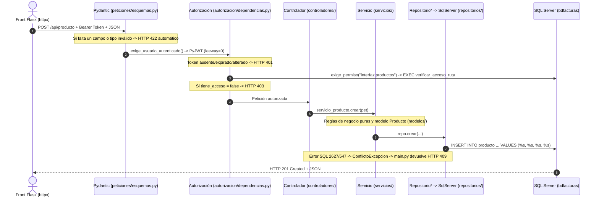

# Flujo Completo de una Petición (FastAPI + Flask)

> Recorrido exacto de una petición desde que la persona hace clic en el
> navegador (`Flask`) hasta SQL Server y de vuelta.

---

## 1. Arquitectura de Procesos Separados

```text
[Navegador] ──HTTP HTML──► [front_python: Flask + Jinja2 (:8099)]
                                  │
                         HTTP + JSON + Bearer JWT
                                  ▼
                           [api_python: FastAPI (:8035)]
                                  │
                         SQL parametrizado / SP (PyMSSQL)
                                  ▼
                           [SQL Server 2022 (:11463)]
```

El frontend en **Flask** (`front_python/app.py`) jamás importa `pymssql` ni tiene acceso a la contraseña de SQL Server en `docker-compose.yml`. Si `api-facturas` se apaga, `front_python` sigue funcionando y muestra el aviso de error de conexión con cero filas.

---

## 2. Capas internas en `api_python/` ante una petición



---

## 3. Regla estricta de separación por capa

| Capa | Carpeta | Qué SÍ hace | Qué NUNCA hace |
|---|---|---|---|
| **Peticiones** | `api_python/peticiones/` | Define esquemas por verbo (`*Crear`, `*Reemplazo`, `*Actualizar`) para validar forma (`422`) | Consultar BD |
| **Autorización** | `api_python/autorizacion/` | Valida JWT (`401`) y ejecuta `verificar_acceso_ruta` (`403`) | Inventar `JOIN` locales |
| **Controladores** | `api_python/controladores/` | Recibe HTTP, invoca el servicio ensamblado y devuelve `200`/`201`/`204` | Escribir SQL ni reglas de negocio |
| **Modelos** | `api_python/modelos/` | Representa entidades tipadas de dominio (`Producto`, `Factura`, `Sesion`) | Depender de FastAPI o `pymssql` |
| **Servicios** | `api_python/servicios/` | Ejecuta reglas de dominio, BCrypt y formato `OPENJSON`; lanza excepciones de dominio | Devolver códigos HTTP |
| **Repositorios** | `api_python/repositorios/` | Define interfaces `ABC` (`interfaces.py`) y ejecuta SQL / SP parametrizado | Decidir reglas de negocio ni HTTP |
