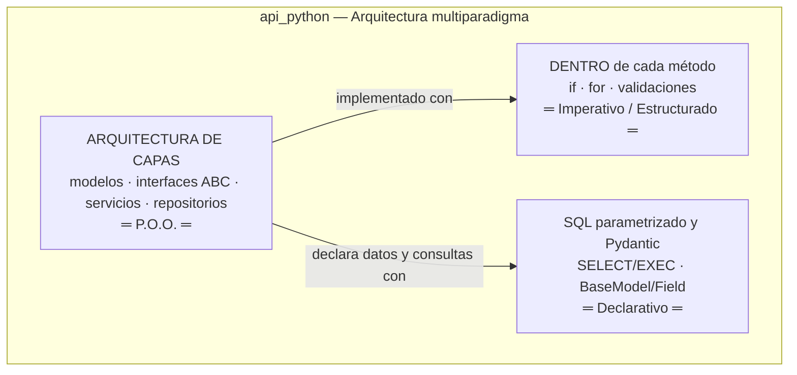
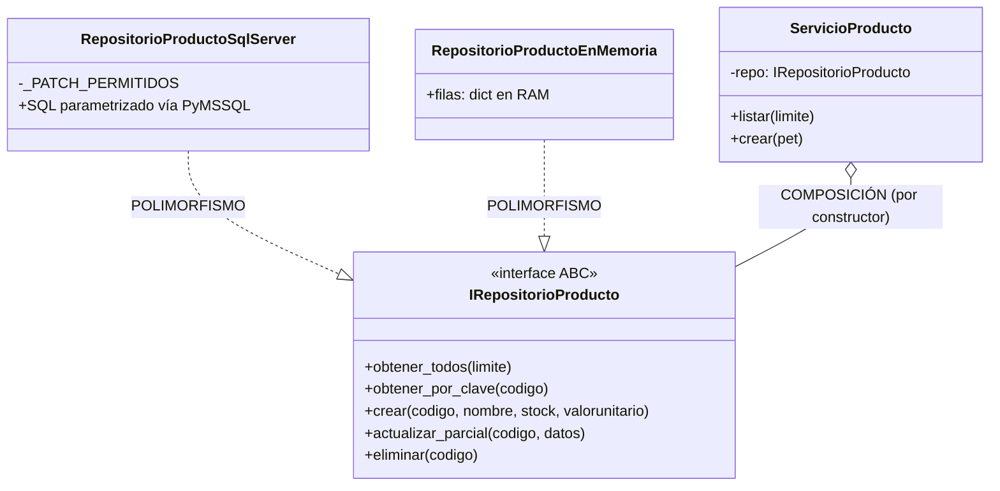

# El paradigma de Programación Orientada a Objetos (P.O.O.) en Python

> Guía conceptual para sustentación presencial sobre la arquitectura real
> implementada en `api_python/` (`FastAPI + PyMSSQL + SQL Server`) y `front_python/` (`Flask + Jinja2`).

---

## 1. Proyecto Multiparadigma a Propósito

Python permite combinar distintos paradigmas según el nivel de responsabilidad:

| Paradigma | Dónde vive en este proyecto | Ejemplo real en código |
|---|---|---|
| **Orientado a Objetos (P.O.O.)** | Modelos, interfaces, servicios, repositorios y excepciones | `api_python/modelos/`, `repositorios/interfaces.py`, `servicios/`, `ensamblador.py` |
| **Imperativo / Estructurado** | Lógica secuencial, condicionales y ciclos dentro de cada método | Validación en `servicio_v1.py`, `ThreadPoolExecutor` en `front_python/app.py` |
| **Declarativo** | Consultas SQL y esquemas de validación Pydantic | `SELECT ... WHERE` en `repositorio_v1.py`, `Field(...)` en `peticiones/esquemas.py` |

---

## 2. Los Cuatro Pilares de la P.O.O. en `api_python/`

### 2.1 Abstracción
Definir **qué** operaciones existen ocultando **cómo** y **dónde** se almacenan los datos.  
En [`api_python/repositorios/interfaces.py`](../api_python/repositorios/interfaces.py), las clases abstractas (`ABC` con `@abstractmethod`) fijan contratos puros: `IRepositorioProducto`, `IRepositorioCliente`, `IRepositorioFactura`, `IRepositorioAcceso`, etc.

### 2.2 Encapsulamiento
Cada módulo protege su estado y detalles internos:
- `RepositorioProductoSqlServer` (en `api_python/repositorios/repositorio_v1.py`) encapsula las consultas SQL, la lista blanca `_PATCH_PERMITIDOS` y el uso de `database.py` (`pymssql`).
- Ni `controladores/` ni `servicios/` conocen cadenas de conexión ni nombres de tablas.
- En el frontend (`front_python/servicios/cliente_api.py`), el token JWT queda encapsulado en el diccionario `SESIONES` del servidor Flask detrás de una cookie `HttpOnly`.

### 2.3 Composición sobre Herencia
El proyecto evita herencias innecesarias entre capas:
- **Composición:** `ServicioProducto`, `ServicioCliente`, `ServicioFactura`, etc. **no heredan** de un repositorio; reciben su interfaz `IRepositorio*` por constructor (`__init__(self, repo: IRepositorioProducto)`).
- **Herencia bien aplicada:** nuestras excepciones de dominio en [`api_python/excepciones.py`](../api_python/excepciones.py) heredan de `Exception` (`NoEncontradoExcepcion(Exception)`, `ConflictoExcepcion(Exception)`) para que `api_python/main.py` pueda capturarlas selectivamente y traducirlas a `404` / `409`.

### 2.4 Polimorfismo (Contrato + Implementaciones)
Dos clases independientes responden exactamente al mismo contrato `IRepositorioProducto`:
1. **`RepositorioProductoSqlServer(IRepositorioProducto)`:** ejecuta `INSERT`, `SELECT`, `UPDATE`, `DELETE` parametrizados contra SQL Server 2022.
2. **`RepositorioProductoEnMemoria(IRepositorioProducto)`:** (en [`api_python/pruebas/test_capas.py`](../api_python/pruebas/test_capas.py)) guarda las filas en un diccionario en RAM para probar `ServicioProducto` sin levantar la base de datos.

---

## 3. El Ensamblador (`api_python/ensamblador.py`)

Siguiendo la regla de inyección de dependencias de la clase, [`api_python/ensamblador.py`](../api_python/ensamblador.py) es el **único** punto donde se instancian las clases concretas `Repositorio*SqlServer` para inyectarlas en cada `Servicio*` que consumen los controladores.
